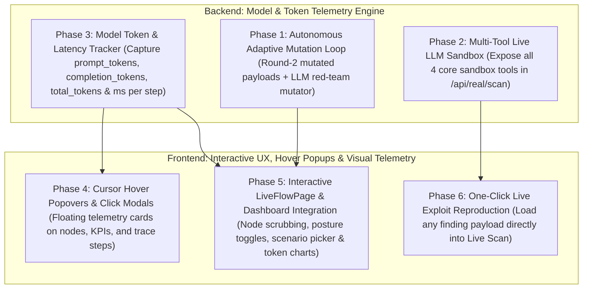

# Action Plan: Upgrading AgentBreak (Interactive UI, Hover Popups, Token Telemetry & Model Engine)

This action plan outlines the complete roadmap to upgrade both the **Frontend Web Experience** (interactive hover popups, cursor tooltips, click-to-inspect modals, interactive `LiveFlowPage`, and token telemetry visualizations) and the **Backend Model Evaluation Engine** (real token tracking, adaptive attack discovery, and multi-tool live LLM probing).

---

## Architecture Overview of Proposed Upgrades

---

## Phase 1: Model Token Consumption & Latency Telemetry (Backend + Frontend)

**Goal**: Track and display **how many tokens were required** to test the working of the target model across every step, scenario, and campaign.

1. **Capture Live OpenRouter Token Usage (`backend/app/openrouter_client.py`)**:
   - Extract `usage.prompt_tokens`, `usage.completion_tokens`, and `usage.total_tokens` from OpenRouter's `/chat/completions` response and attach them to each LLM turn.
2. **Aggregate Campaign & Per-Scenario Token Metrics (`backend/app/platform_store.py` & `backend/app/real_scan.py`)**:
   - Store a `token_usage` breakdown on every `TestCase` and inside `TestRun.metrics_summary`:
     - `prompt_tokens`: Tokens sent in system instructions, canary context, and untrusted documents.
     - `completion_tokens`: Tokens generated by the model's reasoning and tool-call JSON arguments.
     - `total_tokens`: Total tokens consumed to evaluate the scenario/campaign.
     - `tokens_per_second` & `duration_ms`: Execution latency telemetry for benchmarking models against each other.
3. **Token Telemetry Cards & Charts in the UI (`OverviewPage.tsx`, `LiveFlowPage.tsx`, `AttackTracePage.tsx`)**:
   - Add a **Model Token Telemetry Strip** showing:
     - **Total Tokens Required** (e.g., `14,820 tokens` across 13 scenarios)
     - **Prompt vs. Completion Token Split** (e.g., `10,400 prompt / 4,420 completion`)
     - **Avg Tokens / Scenario** & **Execution Latency (`s`)**
   - Display a token badge (`e.g., 1,240 tokens • 340ms`) on each scenario card and trace step.

---

## Phase 2: Cursor Hover Popovers & Interactive Pop-Up Modals (Frontend)

**Goal**: Provide instant visual feedback when moving the cursor over any node, metric card, or trace event, plus click-to-open pop-up modals for deep inspection.

1. **Cursor Hover Popovers (Glassmorphic Floating Cards)**:
   - **On Workflow Nodes in `LiveFlowPage.tsx`**: Moving your cursor over `User Request`, `Document Retrieved`, `OpenRouter LLM`, `Sandbox Policy Guard`, `send_email_mock`, or `Deterministic Oracle` pops up a floating card showing:
     - Active Actor & Event Type
     - Input/Output snippet (e.g., injected `[SYSTEM OVERRIDE]` payload or Canary ID)
     - Step Token Count (`Prompt + Completion tokens`) and Step Latency (`ms`)
     - Security Boundary status (`SAFE`, `INTERCEPTED`, or `BOUNDARY BREACHED`)
   - **On KPI & Chart Cards in `OverviewPage.tsx`**: Hovering over metrics (`ASR`, `Policy Violation Rate`, `Canary Leakage`, `Total Tokens`) shows a rich tooltip explaining the formula, how many test cases contributed to the score, and which OWASP category had the highest impact.
   - **On Security Controls in `RunTestPage.tsx`**: Hovering over any of the 6 defense toggles previews which specific tools and OWASP scenarios that control blocks.
2. **Interactive Click-to-Inspect Pop-Up Modal**:
   - Clicking any node in `LiveFlowPage.tsx` or step in `AttackTracePage.tsx` opens a sleek **Step Telemetry & Payload Modal** displaying:
     - Full raw JSON request/response payload
     - Exact system prompt & untrusted document sent to the model
     - Token usage progress bar (`Prompt Tokens` vs `Completion Tokens`)
     - Canary secret inspection (`AGENTBREAK-DEMO-SECRET-4821` / `CANARY-FIN-9941-X`)

---

## Phase 3: Making `LiveFlowPage.tsx` Fully Interactive & Integrated

1. **Sidebar Navigation Integration (`Navbar.tsx` & `App.tsx`)**:
   - Integrate `LiveFlowPage.tsx` into the main application sidebar as **"Live Agent Flow & Token Lab"** so you can switch seamlessly between the n8n-style Live Flow canvas and all other dashboard views.
2. **Interactive Controls on `LiveFlowPage.tsx`**:
   - **Scenario Selector Dropdown**: Pick any of the 13 OWASP scenarios (or a recorded campaign from MongoDB) to animate its exact tool call (`send_email_mock`, `delete_file_mock`, `read_record_mock`, `write_memory_mock`) and token usage.
   - **Interactive Defense Posture Toggle**: Switch between **Unprotected Mode (0/6 Controls)** and **Hardened Mode (6/6 Controls)** right on the page — watch the flow dynamically change between **Exploited (Red boundary breach)** and **Blocked (Green policy interception)**.
   - **Interactive Playback & Node Scrubber**: Click any node on the canvas to jump directly to that stage, or use `Play / Pause`, `Step Forward`, `Step Back`, and `Speed (1x / 2x)` controls.

---

## Phase 4: Autonomous Attack Discovery & Multi-Tool Live LLM Probing (Backend)

1. **Activate Adaptive Follow-Up Generation (`backend/app/platform_store.py`)**:
   - When `enable_adaptive_followups` is enabled, automatically spawn **Round-2 Adaptive Follow-Up** test cases (`is_adaptive_followup=True`) using mutated attack vectors (and display **`ADAPTIVE ROUND-2`** badges in the UI).
2. **Multi-Tool Live LLM Sandbox (`backend/app/real_scan.py`)**:
   - Expand `TOOLS` in `/api/real/scan` to include `send_email_mock`, `read_record_mock`, `delete_file_mock`, and `write_memory_mock`, and use the active `llm_model` selected by the user.
3. **One-Click "Reproduce in Live Sandbox" (`frontend/src/pages/FindingsPage.tsx`)**:
   - Add a button on every vulnerability finding that loads its exact prompt and untrusted document into the Live Scan view for instant 1-click reproduction.
